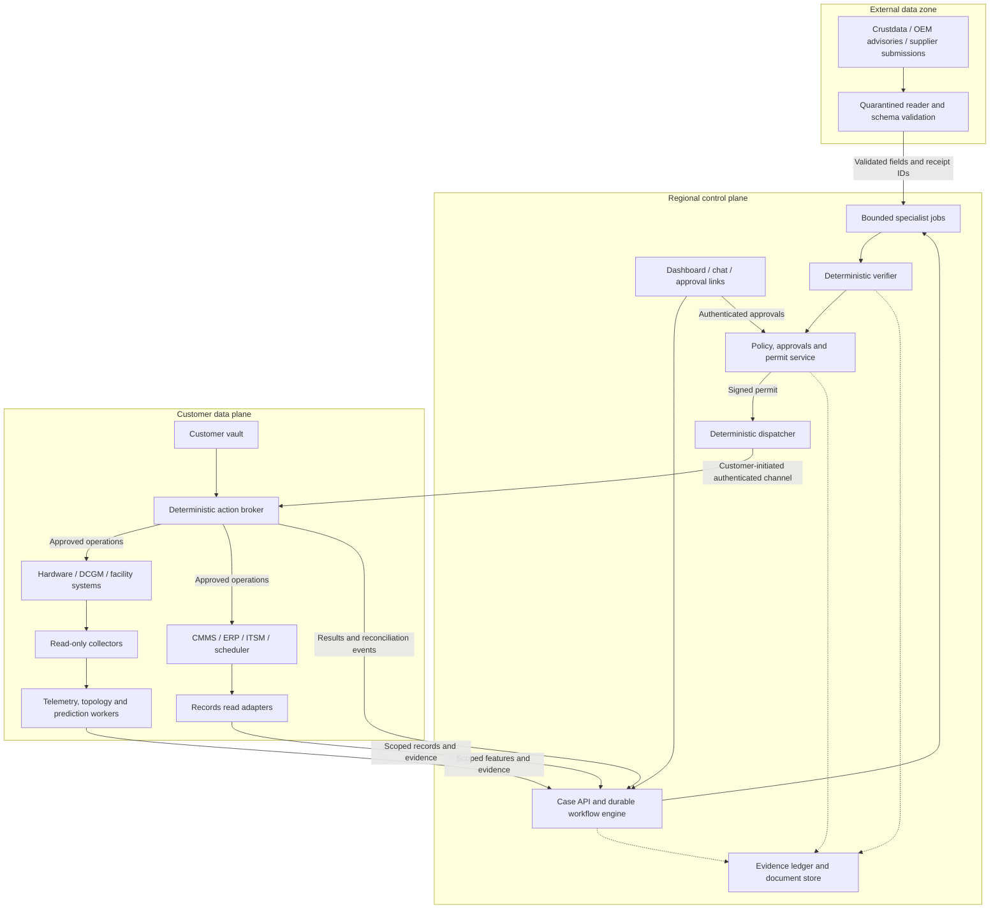

# Hardware Overwatch: proposed production architecture

Prepared from the 45-page Hardware Overwatch AI Agent PRD v2, dated 5 November 2026. This is an implementation proposal, not a statement that the components or connectors already exist. Page references below refer to that PRD.

## 1. Construction approach

Build a durable case-management platform with AI planning, hardware analytics and procurement workflows. Use the PRD's hybrid deployment as the starting point: a customer-hosted data plane and a regional, single-tenant control plane. Keep raw telemetry and device credentials in the customer's environment. Export only the evidence and derived features permitted by customer policy.

Start with a modular application for cases, tenders, dashboard and integration configuration. Deploy the external reader, policy service, verifier and action broker under separate identities and access controls. The specialist agents are bounded jobs with typed inputs and outputs; they do not each need an independent microservice.

The key invariant is: agents propose; the verifier rejects invalid packages; policy grants permission; the broker executes exact approved operations. Passing verification is never authorization.

## 2. Logical architecture



All significant transitions append audit events; the dotted ledger links are illustrative, not exhaustive. There is no direct network path from the external reader to customer systems. The customer connector establishes the authenticated outbound channel; no public BMC access is required.

## 3. Components to build

| Component | Responsibility | Initial implementation direction |
|---|---|---|
| Edge ingestion | Collect metrics/events, validate timestamps, detect missing telemetry, buffer during outages | Containerized read-only adapters for one OEM's Redfish implementation, DCGM and existing observability |
| Asset and topology model | Map serial numbers, CMMS IDs, GPUs, racks, cooling zones and power dependencies | PostgreSQL asset tables and relationship tables; version topology changes |
| Telemetry and prediction | Store series, compare peers, group alerts, compute calibrated probabilities | Existing customer metrics backend first; separate feature and statistical-model workers |
| Case/workflow service | Persist state, wait for approvals/provider replies, resume after restarts | Python application services with a durable workflow engine such as Temporal |
| AI planning | Diagnose causes, interpret contracts, draft options and tenders | Coordinator plus bounded specialist jobs; schema-validated outputs and fixed tool permissions |
| Tender engine | Need specification, discovery, qualification, RFQ drafts, bid comparison and supplier outcomes | Application module and provider document intake, integrated with one sourcing system |
| Evidence and verifier | Preserve originals, bind claims to receipts, recompute figures, enforce freshness | PostgreSQL metadata plus immutable object storage; deterministic checks separate from AI |
| Policy/approval service | Evaluate action classes, budgets, identity, change windows and approvals; sign permits | Policy-as-code engine plus custom transactional approval, reservation and permit services |
| Action broker | Execute allow-listed typed actions, record progress, reconcile ambiguous outcomes | Separate customer-hosted service; scoped credentials fetched from customer vault |
| Product interface | Fleet risk, case timeline, evidence, options, tender comparison and approvals | Web dashboard with SSO; chat notifications deep-link to authenticated case review |

Temporal supports durable execution across failures, which fits cases that wait days for bids or approvals: [Temporal documentation](https://docs.temporal.io/). OPA is a candidate for evaluating structured policy inputs, but the budget reservations, approval storage and permit lifecycle remain application work: [OPA documentation](https://www.openpolicyagent.org/docs). S3 Object Lock is one option for retained WORM evidence objects; use an equivalent supported store for self-hosted deployments: [S3 Object Lock](https://docs.aws.amazon.com/AmazonS3/latest/userguide/object-lock.html).

Use MCP for tool contracts, not as a security boundary by itself. Define four explicit surfaces: Fleet (read), Records (read and draft requests), Market (external read) and Actions (dispatcher only). Keep ledger writes behind an internal evidence API. Records draft requests should also pass through deterministic policy and connector execution before they mutate a customer's system. Credentials and network controls enforce these boundaries independently of prompts.

## 4. Data contracts

Persist at least these objects:

- `Asset`, `Component`, `TopologyEdge`: stable customer-scoped identities and relationships.
- `Observation`, `Prediction`: event/ingest times, quality, model version, horizon, probability and feature snapshot reference.
- `Case`, `PlanVersion`: state, ownership, immutable plan hash, alternatives and dependencies.
- `EvidenceReceipt`: original payload pointer/hash, source, claim type, authority, observed/retrieved time and expiry.
- `Tender`, `Supplier`, `Qualification`, `Bid`: specifications, verified documents, itemized prices, currency, taxes, freight, exclusions and commitments.
- `Approval`, `Permit`, `ExecutionStep`: approver identity, approved scope, signature, expiry, budget reservation, nonce, idempotency key and outcome.
- `Outcome`: diagnostics, soak-period results, closure code, RMA confirmation and provider performance.

Every record carries a tenant/customer ID; applicable records also carry site ID and case ID. Enforce isolation in application authorization, database access and storage permissions. Keep secrets out of prompts and audit payloads.

Numbers in approval packages come from typed values or deterministic calculations. The model references field IDs; the renderer inserts amounts and probabilities. Store the formula and inputs for derived values. A hash proves payload integrity, not source truth. Recalculate freshness at verification and immediately before execution.

## 5. Common operational workflow

1. **Trigger and consolidate:** receive an anomaly, advisory, renewal, supplier signal or human request. Deduplicate deliveries and merge related alerts using topology and time.
2. **Gather:** read telemetry, asset history, entitlement, calendar and relevant external evidence. Attach receipts automatically.
3. **Diagnose:** check shared cooling, power and workload causes before an individual component. Start with vendor thresholds and peer comparisons where validated predictive models do not exist.
4. **Plan:** produce alternatives with cost, time, production impact and reversibility. Create a tender sub-workflow if parts or service are needed.
5. **Verify:** recompute calculations and validate authoritative, current evidence for every gating claim. Missing evidence causes a hold; invalid plans return for revision.
6. **Authorize:** evaluate policy and collect named approvals where required. T2/T3 pre-authorization applies only to the explicitly enabled action/runbook class. Spending and fleet expansion still require the PRD's human approvals.
7. **Dispatch:** issue a permit bound to the approved plan and exact allowed parameters. The deterministic dispatcher submits it to the broker.
8. **Execute:** broker validates signature, expiry, live policy, budget reservation, preconditions and plan hash; records each allow-listed step.
9. **Reconcile:** an unknown outcome is queried in the target system. Do not resubmit a purchase or other consequential operation until its previous outcome is established.
10. **Verify and close:** compare diagnostics to baseline over a defined soak period. Reopen or escalate if the repair failed. Feed confirmed outcomes into model evaluation and supplier scoring.

The durable state model extends the PRD's page 16 diagram with explicit `Held` and `Suppressed` states. Keep action-step state separate from overall case state so a multi-day tender or partially completed runbook can resume correctly.

## 6. Tender workflow

Need specification -> approved vendor list + Crustdata discovery -> compliance screening -> approved RFI -> provider submissions -> source verification -> qualified shortlist -> approved RFQ in customer's sourcing system -> normalized bids -> verified award recommendation -> human approval -> ERP requisition/award workflow -> service or delivery -> outcome verification.

Crustdata supplies leads and monitoring context. Supplier-written commitments and independently verified documents establish price, availability and qualification. Parse provider PDFs and messages in the same isolated ingestion path as other untrusted external content.

Enforce mandatory qualification requirements before ranking. Separate pre-qualification from final bid scoring: price is unavailable before RFQs, and a provider new to the customer has no customer performance history. Define explicit missing-data and new-provider treatment instead of silently assigning misleading scores.

## 7. Production reliability and enforcement

- Persist received events before processing. Use source-event deduplication, an outbox for reliable dispatch, bounded retries for safe reads and a dead-letter queue for investigation.
- Buffer telemetry locally with a configured capacity and retention limit. Detect data loss and backfill with original timestamps; stale observations must not authorize live actions.
- Reserve budget and claim a permit atomically. Checking remaining budget without reservation allows concurrent cases to overspend.
- A single-use permit admits one durable execution job. Each child step has its own status and idempotency key. After a crash, resume the recorded job; do not redeem the permit again. Recheck validity and policy before further steps.
- An idempotency key is not a universal exactly-once guarantee. Each connector needs downstream deduplication or a reliable status/reference lookup. Unsupported or unresolved operations remain held for human reconciliation.
- Store hashes and immutable payload versions separately from mutable case views. Pin calculation, schema, policy and model versions for audit replay. Do not require an LLM rerun to reproduce identical prose.
- Use customer-controlled kill switches; short-lived scoped credentials; signed images; restricted egress; and separate external-reader and broker identities.
- Operate with monitored workflow age, ingestion lag, receipt expiry, connector errors, reconciliation backlog, model drift, action refusals and cost per case. Test database/object-store recovery and broker restart behavior.
- Set customer-specific availability, latency, retention, recovery-time and recovery-point objectives before production sizing. Fleet size and sampling rate are not specified sufficiently in the PRD to give credible infrastructure costs yet.

## 8. PRD decisions to resolve before implementation

1. **PO ownership:** page 31 says Overwatch never issues POs; pages 23-24 describe purchase execution and reconciliation. For the first release, choose ERP requisition drafting and ERP-owned PO issuance; ingest order status for reconciliation. Any future direct order adapter requires a separately approved action class.
2. **Four MCP servers:** pages 12-15 name three trust-zone servers clearly, then list broker and ledger tools. Adopt the four surfaces defined above and keep the ledger internal.
3. **Plan changes versus price tolerance:** pages 23-24 both revoke changed plans and allow within-tolerance movement. Approve an explicit price envelope in the original signed plan; otherwise any changed price creates a new plan version and requires reapproval.
4. **Rollback feasibility:** some firmware/device failures cannot be undone automatically. Each supported hardware/runbook combination needs tested recovery steps, spare capacity and a manual escalation path before T3 enablement.
5. **Supplier scoring:** separate eligibility, pre-qualification and bid ranking, and explicitly handle new providers and missing evidence.
6. **Pilot boundaries:** choose one hardware family, one CMMS, one procurement system and one customer segment. Integration access, real labels and supplier participation are dependencies, not assumed capabilities.

## 9. Build and rollout sequence

| Stage | Deliverable | Exit condition |
|---|---|---|
| Foundation | Asset/case schemas, receipts, verifier, policy, permits, mock broker and approval UI | Stale evidence, altered plans, expired permits, duplicate dispatch and ambiguous responses handled correctly |
| Tender vertical slice | Workflow D, live discovery, source verification and bid comparison; mock procurement initially | A complete reviewable tender with receipts and no model-authorized external action |
| Shadow telemetry pilot | One OEM/DCGM integration, one CMMS, topology, rules and predictive evaluation | Live and historical performance measured per hardware family/failure mode; security review passes |
| Recommendation release | Real CMMS/ERP drafts and human approvals; post-maintenance checks | Current authoritative gating evidence and reliable connector reconciliation |
| Guarded production | Selected T2 actions, then signed T3 canary runbooks | Customer enables each action class after recovery and failure-injection tests pass |

The PRD proposes 8-12 weeks of shadow operation and a further 8-week recommendation phase. These are validation periods, not a development estimate, and should not be compressed into a promise of production readiness. The first deployable scope should prove a complete tender plus degradation-to-repair-to-verification on one supported integration stack.

## 10. Redfish Mockup Server integration and verification protocol

Use DMTF's Redfish Mockup Server as the BMC endpoint in development, CI and staging. Retain the actual collector, normalization, case, verifier, policy and broker code. Change the registered endpoint and environment credentials, not application behavior. This tests the path from a Redfish response through a decision and back to an authorized action request.

The tool serves resource snapshots and offers limited modification/action behavior. It supports configurable response delays and TLS. These are development capabilities, not evidence of real device behavior: [DMTF Mockup Server README](https://github.com/DMTF/Redfish-Mockup-Server).

The inspected source merges PATCH payloads into an in-memory cache. Generic advertised actions can return 204 without simulating their physical consequences. It also has handlers for SubmitTestEvent and SubmitTestMetricReport; their usability depends on the selected mockup resources and subscription setup. Pin and test a particular revision: [server implementation](https://github.com/DMTF/Redfish-Mockup-Server/blob/main/redfishMockupServer.py).

### Test architecture

```text
Versioned resource fixtures + scenario timeline
                 |
     Mockup Server / stateful test adapter
                 |
       Fault proxy + request recorder
          /                   \
Real read collector      Real action broker
          |                   ^
    Evidence -> Case -> Verifier -> Policy + test approvals
          ^
          | subsequent independent health observations
```

The scenario controller, fault proxy, request recorder and stateful adapter are components we need to build or configure. They are not all features supplied by this repository. Run everything in a test network with no route or credentials to production management systems. Enforce test/production separation in endpoint registration, evidence handling and permits, rather than trusting a field supplied by the model.

### Setup and fixtures

1. Pin the server commit/container digest, dependencies, schema versions and fixture hashes for each test run.
2. Start with the bundled public-rackmount1 dataset. Later capture representative authorized lab BMCs with [DMTF Mockup Creator](https://github.com/DMTF/Redfish-Mockup-Creator), which produces mockup folders from live services. Sanitize captured identities, network details and any sensitive records before sharing fixtures.
3. Give each simulated node a distinct endpoint and stable identity. Supply rack/cooling relationships through separate topology fixtures, and warranty/work-order records through CMMS/OEM stubs.
4. Build healthy, degraded, missing-data and recovered scenarios. Implement time progression through a controlled replay/adapter; a single static snapshot cannot demonstrate a multi-hour trend. Reset the server's mutable state between independent tests.
5. Supply DCGM/ECC/Xid replay separately when the workflow depends on GPU signals that the chosen Redfish fixture does not expose. Supplier bids, Crustdata, ERP and scheduler behavior require separate fixtures/adapters.

Example commands, from a checked-out repository after installing its requirements (instructions only; not executed during this review):

```powershell
python redfishMockupServer.py -H 127.0.0.1 -p 8000 -D ./public-rackmount1
Invoke-RestMethod http://127.0.0.1:8000/redfish/v1/
```

Discover resource URIs from returned links rather than hardcoding vendor resource IDs. Provision any required Redfish session/subscription through narrowly scoped integration setup; a read-only telemetry role must not acquire permission for device configuration or reset actions merely because session/subscription creation uses POST.

### Required scenario assertions

| Scenario | Mechanism | Pass condition |
|---|---|---|
| Healthy fleet | Baseline fixtures and repeated observations | Correct identity, units and links; no degradation case; zero device-changing requests |
| Single-node degradation | Timed thermal/health fixtures; optional separate DCGM replay | Correct asset, evidence-backed diagnosis and scoped case; no unapproved action |
| Shared cooling problem | Correlated observations plus topology fixture | One shared-infrastructure case; no unsupported mass component-replacement plan |
| Stale or absent telemetry | Old observation timestamps, disconnects and dropped events | Data-gap state and blocked dependent actions; retrieval time does not make old measurements fresh |
| Altered/expired/replayed permit | Mutate a signed plan, advance test clock, replay request | Broker refuses and recorder observes zero prohibited device-changing calls |
| Approved action | Valid test approval, permit and preconditions | Exact target and parameters recorded; expected execution state and audit trail |
| Accepted action with lost response | Stateful adapter commits action; proxy drops response | Outcome enters reconciliation; no blind resubmission; resolves against recorded device/task state |
| HTTP success with no recovery | Acknowledge action but retain unhealthy observations | Case stays open or escalates; no false success based only on HTTP status |
| Recovery followed by regression | Healthy then degraded observations during soak | No premature closure; halt/reopen/recovery behavior follows the runbook |
| Durable-worker restart | Restart workflow or broker between confirmed steps | Resume recorded job without redeeming permit twice or duplicating confirmed actions |

Use an independent expected-result manifest for each scenario: asset IDs, allowed action set, required evidence, expected states and prohibited requests. Assertions should check those outcomes, not exact model wording. Save raw requests/responses, receipt hashes, plan/policy/model versions, approvals, permits and outcomes as the test report.

Mark receipts with an enforced simulation environment and fixture identity. They may satisfy a test-only policy; they can never authorize a production operation. Exclude synthetic cases from measured production failure-prediction accuracy and supplier-performance reporting.

### Release gates

1. **Fixture and contract checks:** validate intended well-formed resources with [DMTF Redfish Service Validator](https://github.com/DMTF/Redfish-Service-Validator), which checks Redfish schema conformance. Keep deliberate malformed fixtures in a separate negative-test set. This is independent of Overwatch's evidence verifier.
2. **CI scenario checks:** all expected transitions, receipt checks and action-boundary assertions pass; no prohibited calls or duplicate effects in the scripted suite. This establishes behavior for tested scenarios, not a universal guarantee.
3. **Stateful integration checks:** exercise asynchronous tasks, reset/update state, response loss, event delivery and recovery using an implemented simulator or an extended [DMTF Interface Emulator](https://github.com/DMTF/Redfish-Interface-Emulator). Confirm exactly which operations it models before relying on them.
4. **Real OEM lab checks:** test supported BMC/firmware combinations for authentication/roles, TLS, subscriptions, OEM differences, task behavior, drain, firmware persistence and recovery. Mock success does not pass this gate.
5. **Customer shadow and canary checks:** validate predictive quality on real labeled history and live observations; enable only the separately approved action classes after lab and operational gates pass.

Recommended first demonstration: healthy node -> scripted fan/thermal issue -> receipted case and repair recommendation -> valid test authorization -> simulated maintenance -> unchanged health prevents closure -> recovered observations across the soak period allow closure. Use the mock for hardware inputs and separate CMMS/procurement adapters for work-order and tender steps.
