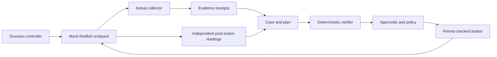

# Redfish development and verification lab

Two different tools are intentional:

| Tool | Purpose |
|---|---|
| WatcherMCP `LabServer` | Controlled healthy/degraded/stale/dark/recovered states, recorded action outcomes and a lost-response scenario |
| DMTF Redfish Mockup Server | Real upstream resource-serving behavior and compatibility with published Redfish mockups |

The application uses the same `RedfishClient` for both. Only the WatcherMCP lab exposes the simulation action adapter's special endpoints. Real BMC and DMTF endpoints are not silently treated as that lab.

## Flow



No private management network or real BMC credentials are needed for this lab. The simulator's in-memory operation registry survives application restarts while the simulator stays alive; it does not survive a simulator process restart. The app correctly leaves such unresolved operations unknown.

## DMTF pin and startup

The upstream commit is `23d21f9a3610f6b6fbb71ffc941296b159a524d2`. Its public-rackmount1 directory uses short-form layout, so our launch command explicitly supplies `-S`:

```text
python redfishMockupServer.py -H 127.0.0.1 -p 8000 -D public-rackmount1 -S
```

The repository's Compose service exposes port 8000 only on loopback. The container is read-only except `/tmp`, drops Linux capabilities, and runs as a non-root user. The image recipe is provided; native tests are the locally verified execution path.

## Snapshot interpretation

The collector follows links instead of assuming vendor resource IDs. Supported temperatures come from legacy Thermal collections or temperature Sensor resources. It uses a stable serial number/UUID as the asset identity and records timestamp provenance.

A static file fetched now is not proof that its embedded measurement was made now. When a measurement timestamp is absent, the receipt is marked `retrieval_only`; verification blocks the dependent action. Adapt and validate timestamp mappings per OEM before enabling anything beyond observation.

The inspected upstream implementation returns success for some generic advertised actions without applying device-state changes. The integration test demonstrates that behavior. Our post-check therefore always observes health independently.

## Adding OEM fixtures

Capture an authorized lab BMC using DMTF Mockup Creator. Remove sensitive identities, management addresses and account/network details before committing. Record fixture provenance and a hash. Add tests for stable asset identity, supported resource layout, missing fields, current/stale timestamps and errors. Validate standards-conformant fixtures with DMTF Service Validator; synthetic malformed fixtures belong in a separate negative-test suite.

## Sources

- [Mockup Server](https://github.com/DMTF/Redfish-Mockup-Server)
- [Pinned server implementation](https://github.com/DMTF/Redfish-Mockup-Server/blob/23d21f9a3610f6b6fbb71ffc941296b159a524d2/redfishMockupServer.py)
- [Mockup Creator](https://github.com/DMTF/Redfish-Mockup-Creator)
- [Service Validator](https://github.com/DMTF/Redfish-Service-Validator)
- [Interface Emulator](https://github.com/DMTF/Redfish-Interface-Emulator)
